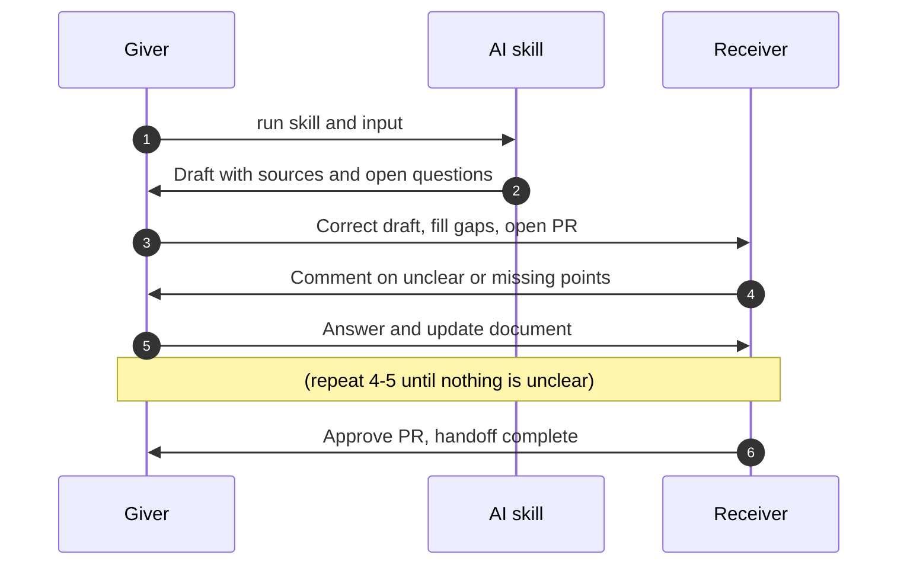

# Transfer Flow Utility - Project Overview

## 1. Team Charter

### 1.1 Decision Process

- **Default: the owner decides.** The person responsible for a piece of work, such as the PR author, makes the decisions within that work. Teammates can review and comment through the PR or the team channel within 24 hours.
- **Raising a disagreement.** Any teammate can object to a decision. The objection must include a reason and supporting evidence, such as test results, project requirements, technical documentation, user feedback, or a reproducible example. Personal preference alone does not block a decision.
- **Resolving a disagreement.** The people involved discuss the evidence. If they cannot agree within 48 hours of the objection, the current Code Steward makes the final decision.
- **When the Code Steward is part of the disagreement.** The other three members decide by majority vote.
- **Recording.** Every Code Steward ruling, every vote, and every significant decision is recorded in `DECISIONS.md`, including what was decided and why.

### 1.2 Definition of Done

A piece of work is done only when every applicable item below is true.

**All work**

- The work is tracked by a GitHub Issue, and the PR links to it.
- The PR template is fully filled in, including AI Usage and Human verification. The Decision section is filled in whenever the PR makes a significant choice.
- At least one teammate other than the author has reviewed the actual result, such as the rendered document or the running feature, and approved the PR.
- Related documents, such as `README.md` and `DECISIONS.md`, are updated to match the change.
- The PR is merged into `main`, and the linked issue is closed.

**Additional items for code work**

- New or changed behavior is covered by tests.
- All tests pass. Until CI is set up, the author runs the tests locally and states the result in the PR.
- The reviewer runs the code and confirms that it behaves as the PR describes.

### 1.3 Communication Outside Class

**Channels**

- **Discord** is the main channel for day-to-day discussion, questions, and meeting coordination.
- **GitHub** is the record for work: tasks live in GitHub Issues, and code and document review happens in PR comments. Decisions agreed on Discord are copied to the related issue, PR, or `DECISIONS.md`, so nothing important exists only in chat.

**Meetings**

- Each member submits a weekly text report on Friday, covering what is done, what is pending, blockers, solutions, and open issues.
- The team holds a stand-up meeting in class every two weeks to assign issues and resolve open questions.
- Extra meetings can be called when needed, for example before a checkpoint deadline.

**Response times**

- Regular messages: reply within 24 hours.
- PR review requests: review within 48 hours, leave the first 24 hours for other team members to comment unless all the members explicitly agree.
- Urgent messages: start the message with `[URGENT]` and tag everyone. Members reply within 6 hours.

**When a member cannot be reached**

- If a member does not respond within 48 hours, the team proceeds with the decision process in 1.1 without waiting.
- If a member stays unreachable and their assigned issues block other work, the team reassigns those issues at the next meeting and records the change in `DECISIONS.md`.

## 2. Problem Statement

### 2.1 The Pain Point

**Who has the problem.** Members of small university course project teams, about three to five people, building software or AI projects. These teams often divide the work at the start, then work mostly on their own and coordinate through chat apps such as LINE or Discord instead of regular meetings.

**When it happens.** Whenever work moves from one member to another:

1. **Takeover:** a member hands a piece of work to a teammate who continues it.
2. **Integration:** members who worked in parallel combine their parts.

**What goes wrong.** At these moments, the receiving member is missing two kinds of information. A handoff is complete only when both are transferred:

- **Why (idea alignment):** the decisions and assumptions behind the work, such as how the code should be structured or which settings to use, and the reasons for them. Without this, members find out late that they understood the same thing differently.
- **What (work status):** what has been done, its current state, what remains, and what should happen next. Without this, members do not know what the others are doing or how the parts will fit together.

This information usually exists only in each member's head or in scattered chat messages. The receiving member has to ask through chat and wait for replies, and inconsistencies can stay hidden until integration, when fixing them costs the most time.

**What we do not know yet.** Our evidence so far comes from a small number of conversations. We have not yet measured how much time these problems cost, or how often they occur across different teams.

### 2.2 Evidence from Users

**Interviewee A: university student, deep learning course project (in-person conversation)**

- **Context.** For a final project in a deep learning course, A's four-person team trained an image generation model. They had no regular meetings and communicated only through LINE messages. The only shared document was a plan written at the start, describing the project direction and a rough division of work. After that, each member worked alone and contacted the others only when something was unclear. Members differed in how carefully they worked and how much they documented.
- **What went wrong.** Problems surfaced only at integration:
  - *Idea alignment:* members held different understandings of the same things, including how functions in the code should be written and which training settings to use. A assumed one approach, while another member had something else in mind.
  - *Work handoff:* because work was divided only roughly, members did not know clearly what the others were doing, and nobody considered how the parts would fit together.
- **Cost.** The team spent extra time reconciling the inconsistencies at the end. Finding out what others were thinking or how they had done something required LINE messages and waiting for replies, which slowed things down.
- **Current approach.** No specific solution. Because it was a one-time course project, the team absorbed the cost by spending extra time.

**Interviewee B: university student, software engineering course project (online text discussion)**

- **Context.** As the student PM of a 17-member team developing an online mobile game, B managed the project from ideation through presentation. B ran weekly in-person meetings, using Discord and HackMD for collaboration. However, the large team size created high communication costs. Furthermore, with four international students from Japan and Indonesia, B frequently faced alignment and consensus challenges due to cognitive and cultural gaps.
- **What went wrong.**
  - *Low Meeting Efficiency*: Most members were reluctant to participate during in-person meetings, resulting in low efficiency and making it difficult for engaged members to reach a consensus.
  - *Misaligned Consensus*: Compounded by language barriers, teammates often misunderstood shared decisions, which ultimately caused actual development outcomes to deviate from initial expectations.
  - *Unclear Documentation*: Documents typically contained only brief summaries, leaving most members unable to understand the context, discussion process, or reasoning behind each decision after meetings.
- **Cost.** B had to spend extra time verifying that all sub-teams shared the same understanding and agreed on decisions regarding each topic discussed. Sub-team leaders also had to constantly monitor whether members' actual implementations aligned with what had been agreed upon. Since most members were hesitant to speak up, the PM often had to call on individuals one by one to check their thoughts even during in-person meetings.
- **Current approach.** Instructed team leaders to pay close attention to members who frequently misunderstood meeting decisions and provided timely support. Incorporated concrete examples into documentation to prevent misinterpretation. Increased communication frequency to regularly check in on each team's development progress.

### 2.3 Why Existing Tools Fall Short

| Current approach | What it does well | Why it falls short for handoff |
|---|---|---|
| **Chat apps** (LINE, Discord) | Fast, and everyone already uses them | Decisions and status are scattered across long message histories with no structure. To learn what a teammate decided or did, the receiver has to ask and wait for a reply, as Interviewee A described. |
| **Planning documents** (Google Docs, Notion, HackMD) | Give the team a shared starting point | Usually written once at the start. In Interviewee A's team, the initial plan was the only shared document, so later decisions and changes were never written down. |
| **Meetings** | Allow real-time discussion and clarification | Require everyone to be available at once, and what was agreed is often not recorded. Members who missed the meeting, or who later take over the work, do not get the reasoning. |
| **Issue trackers** (GitHub Issues, Jira, Trello) | Track which tasks exist and who owns them | Focus on task status (the What). The reasons behind decisions (the Why) are not a required part of an issue, and many course teams do not use a tracker at all. |
| **General AI assistants** (ChatGPT, meeting summary tools) | Can quickly condense long discussions | Output has no fixed structure for decisions, reasons, status, and next steps. Nobody is required to check it for errors, and when each member summarizes separately, the team does not end up with one agreed version. |

**The gap.** None of these approaches produces, at the moment of handoff, a single record that covers both the Why and the What, follows a consistent structure, and has been checked by a human before the team relies on it.

## 3. Interaction Design Sketch

This is an initial design and is expected to change during the semester.

### 3.1 What the Tool Does

Transfer Flow Utility is an agent skill, run through an AI coding agent such as Codex or Claude Code, inside the team's repository. When a member is about to hand off work, they run the skill. It collects the scattered context around that work and drafts a structured handoff document that covers both the Why (decisions and their reasons) and the What (completed work, current status, and next steps). The AI only drafts. The person handing off corrects the draft, the person receiving it confirms they understand it, and only then does the document become the team's shared record.

### 3.2 Inputs and Outputs

**Inputs**

| Input | Example |
|---|---|
| Chat history | Exported LINE or Discord messages about the work |
| Git history | Commits, PRs, and code changes on the related branch |
| Meeting notes and documents | Meeting notes, the project plan, existing design documents |
| The giver's own notes | A short free-form explanation written by the person handing off |

**Output**

A Markdown handoff document saved in the repository, for example `handoffs/2026-11-02-training-pipeline.md`, with these sections:

- **Decisions:** each decision, its reason, and rejected alternatives if known
- **Completed work:** what has been done
- **Current status:** what state the work is in, including known issues
- **Next steps:** what remains and what the receiver should do first
- **Open questions:** information the AI could not find in the inputs, marked for the giver to fill in instead of guessed
- **Review record:** who corrected the draft and who confirmed it
- **Quiz:** key questions on the What and the Why of the work, so the receiver can check whether they really understand the handoff.

Each item links to its source, such as a commit, a PR, or a quoted message, so that reviewers can check it against the original.

### 3.3 How Two People Interact

The two roles are the **giver**, who hands off the work, and the **receiver**, who takes it over or integrates it.

1. The giver runs the skill and provides the inputs.
2. The AI drafts the handoff document, links each item to its source, and lists what it could not find as open questions.
3. The giver corrects errors, fills in the open questions, and opens a PR containing the document.
4. The receiver reads the document in the PR and comments on anything unclear or missing.
5. The giver answers by updating the document. Steps 4 and 5 repeat until the receiver has no remaining questions.
6. The receiver approves the PR. The merged document is the team's agreed record of the handoff.

**Integration.** When several members worked in parallel, each of them follows the same flow, with the integrator as the receiver. Because every handoff document lists its decisions in the same structure, the skill can compare the documents and flag decisions that appear to conflict, such as different training settings. The integrator reviews each flagged conflict with the members involved, and they decide which choice to keep before combining the code. This conflict check is tentative and may be dropped or changed as the design develops.
